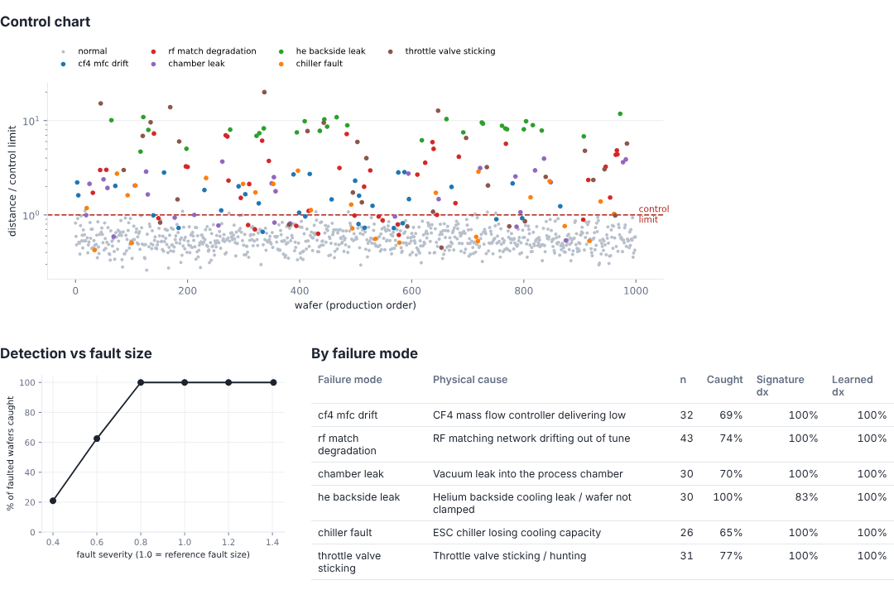
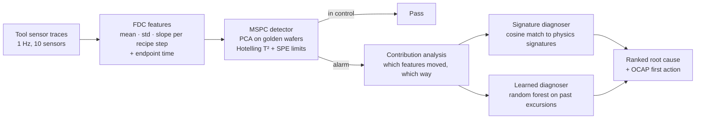
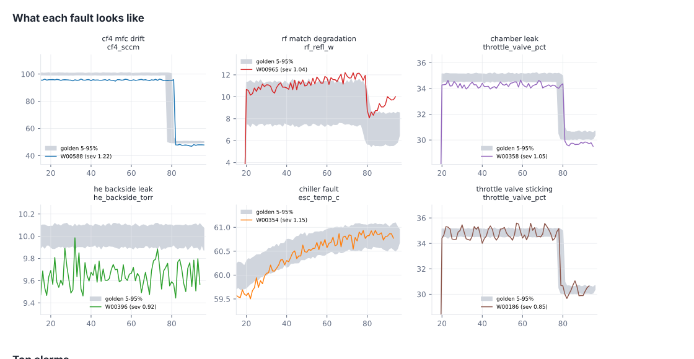

# FabSentinel

**Fault detection and root-cause diagnosis for semiconductor process tools.**

When an etch chamber starts drifting, the expensive part isn't noticing that something is off. It's knowing *what* is off before the next lot runs. FabSentinel watches every wafer's sensor traces, flags excursions with multivariate statistical process control (MSPC), and returns a ranked root cause plus the first out-of-control action (OCAP) a technician should take.



## Results

Benchmark: 200 golden wafers for training, then 1,000 unseen production wafers with faults injected into ~20% at random severity (`fabsentinel benchmark`).

| Metric | Result |
| --- | --- |
| False alarm rate (good wafers flagged) | **1.0%** |
| Alarm precision | **94.8%** |
| Faults caught: low / medium / high severity | 33% / 88% / **100%** |
| Root cause correct, physics signatures (no labelled history) | **96.6%** top-1, 97.3% top-2 |
| Root cause correct, random forest (trained on past excursions) | 100% top-1 |

Low-severity faults are deliberately near the noise floor; the detection curve shows where the method stops seeing them.

## How it works



1. **Simulator** (`simulator.py`): a three-step oxide etch recipe (stabilise, main etch to optical endpoint, over-etch) with 10 sensors: chamber pressure, throttle valve position, RF forward and reflected power, CF4/O2/Ar flows, ESC temperature, helium backside pressure, and the 703 nm fluorine emission line. It includes wafer-to-wafer noise and chamber seasoning drift between wet cleans. Six faults couple across sensors the way they do on real tools; for example, a CF4 mass-flow-controller drift lowers fluorine emission *and* stretches endpoint time.
2. **FDC features** (`features.py`): per step and sensor, the mean, standard deviation and slope, after skipping each step's settling transient. That gives 82 informative features per wafer.
3. **Detector** (`model.py`): standardise against golden wafers, keep the principal components that explain 80% of normal variation, then compute Hotelling's T² (unusual *within* the normal pattern) and SPE/Q (*breaks* the pattern). The SPE limit comes from out-of-fold residuals: in-sample residuals are optimistically small, and using them produced a 77% false-alarm rate in early testing.
4. **Diagnosis** (`diagnose.py`):
   - **Signature diagnoser:** encodes each failure mode as an expected direction per sensor (a leak opens the throttle valve less and raises pressure; a helium leak drops backside pressure and heats the ESC). It works on day one, with no labelled faults.
   - **Learned diagnoser:** a random forest trained on past labelled excursions. It does better once a fab has history.



## Run it

```bash
pip install -e ".[dev]"
fabsentinel diagnose rf_match_degradation --severity 0.8   # one wafer, explained
fabsentinel benchmark --out out                            # metrics.json + report.html
pytest
```

Example:

```
Wafer W00201: injected rf_match_degradation at severity 0.8
T2 69.0 (limit 79.2)   SPE 157.5 (limit 57.0)
Likely root causes:
    98%  rf_match_degradation
Strongest deviations: main.rf_refl_w.slope +10.0σ, main.rf_refl_w.std +6.1σ, ...
First action: Check match network tune positions and reflected-power trend; inspect RF cable and connectors.
```

## Limits

- **The data is simulated.** Real tools have correlated drifts, recipe changes, PM events and sensor dropouts that this simulator only approximates. The learned diagnoser's 100% reflects how separable the simulated faults are, not production performance.
- **Each fault is single and isolated.** Two simultaneous faults would blur the signatures.
- **The next step is real FDC data:** for example SECS/GEM trace exports or a public dataset such as the Tennessee Eastman process, plus adaptive limits that re-baseline after preventive maintenance.

## Why

Several companies in YC's Summer 2026 batch are building AI that diagnoses and runs industrial equipment. This project is an open, from-scratch take on the core of that problem, informed by three years as a process engineer at Infineon Technologies.

MIT License.
